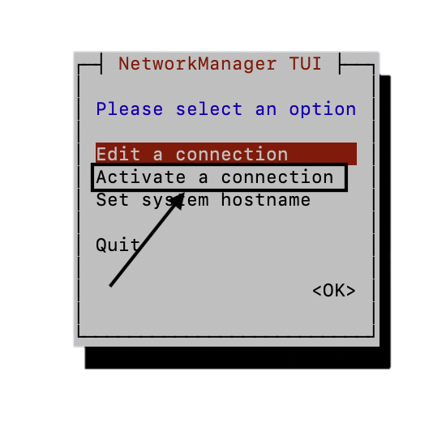

# Подключение к Wi-Fi сети

Вначале, вам нужно будет настроить роутер, к которому будут подключаться ваши дрон и ноутбук для запуска сервера 
после настройки подключите кабель-Ethernet к вашему orangepi так, чтобы загорелись желтый и зеленый светодиоды
а затем подключитесь к нему [по SSH](https://docs.skyris.ru/technic6S/SSH.html)
Но бывает такое, что нет просто возможности подключить дрон по кабелю-Ethernet, по этому можно подключить сам дрон через установленную утилиту nmtui

Порядок действий: 
1. Пропишите команду:
 ```bash
 nmtui
 ```
2. В открывшемся меню выберите(управление стрелочками):


3. Затем выберите сеть, к которой вы хотите подключится
4. Введите пароль 
5. После выхода из утилиты, узнайте в терминале на каком ip ваш дрон: 
 ```bash
 ip a
 ```

после этой команды найдите такую строчку:
 ```text
 3: wlan0: <BROADCAST,MULTICAST,UP,LOWER_UP> mtu 1500 qdisc fq_codel state UP group default qlen 1000

    link/ether 9c:b8:b4:f1:d4:ae brd ff:ff:ff:ff:ff:ff

    inet 192.168.x.x/24 brd 192.168.0.255 scope global dynamic noprefixroute wlan0
 ```
`192.168.x.x` - будет вашим ip и уже по нему надо будет подключиться по SSH

после подключения выполните следующие команды

 6. опустите точку доступа:
 ```bash
 sudo nmcli connection down technic-ap
 ```

 7. удаляем точку доступа(если она будет нужна - пропустите):
 ```bash
 sudo nmcli connection del technic-ap
 ```

 8. выключаем сервис точки доступа:
 ```bash
 sudo systemctl stop hostapd
 ```

 9. выключаем auto-start сервиса точки доступа:
 ```bash
 sudo systemctl disable hostapd
 ```

 10. после этого опустим и поднимем wlan0:
 ```bash
 sudo ip link set wlan0 down
 sudo iw dev wlan0 set type managed
 sudo ip link set wlan0 up
 ```

 11. теперь проверьте interface: "type managed":
 ```bash
 iw dev
 ```

 12. проверьте есть ли Ваша wi-fi сеть:
 ```bash
 nmcli device wifi list
 ```

Есть ли она есть произведите подключение к вашей wifi сети
через данную комнаду
 ```bash
 sudo nmcli device wifi connect "SSID" password "PASSWORD"
 ```
