# Поворотный кронштейн камеры

### Этап 1: сборка

### Шаг 1: Установка сервопривода

Используется:
- Сервопривод - 1шт;
- Маунт - 1шт;
- Саморез М2.5x8 - 2шт.

Установите сервопривод на маунт, как показано на рисунке 1, и зафиксируйте двумя саморезами М2.5x8

  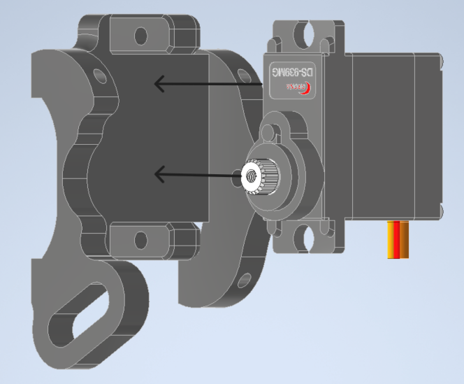
  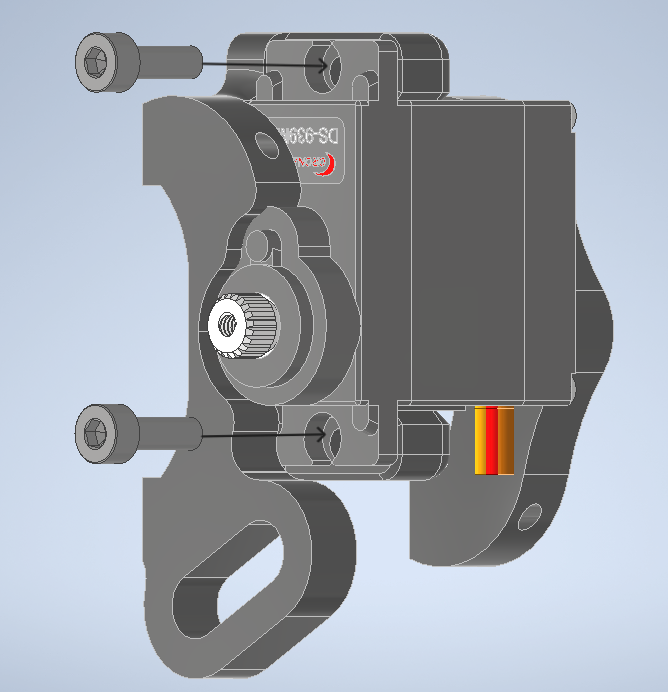

Рис. 1

### Шаг 2: Настройка сервопривода и установка боковых стоек

Используется:
- Сервопривод с маунтом, собранный на шаге 1;
- Левая боковая стойка - 1шт;
- Правая боковая стойка - 1шт;
- Винт M2x10 - 1шт;
- Винт M3x10 - 1шт;
- Подшипник или пластиковая проставка под М3 (внешний диаметр до 6 мм) - 1шт.

Установите сервопривод в центральное положение (1500). Вы можете подключить кабель от него к полётному контроллеру и осуществить настройку, как описано в [данной статье](#).

Настройку также можно осуществить с помощью тестеров, как на рисунке 2.

  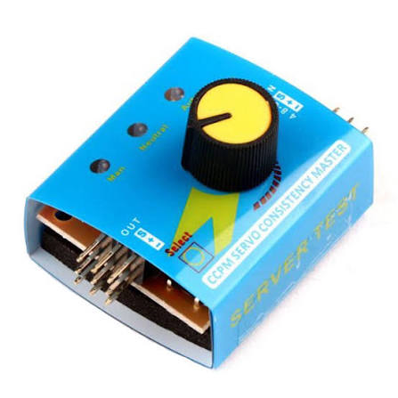
  

Рис. 2

Задайте значение "1500" или поверните потенциометр на среднее положение (зависит от типа тестера).

В крайнем случае, на сервопривод можно одеть качалку и вручную найти крайние положения, а после, повернуть её примерно на середину.

После настройки присоедините к сервоприводу левую боковую стойку, под углом в 90 градусов, как на рисунке 3, прикрутите винт M2x10, но не перетягивайте его сильно, чтобы избежать заклинивания механизма и последующего выхода из строя.

  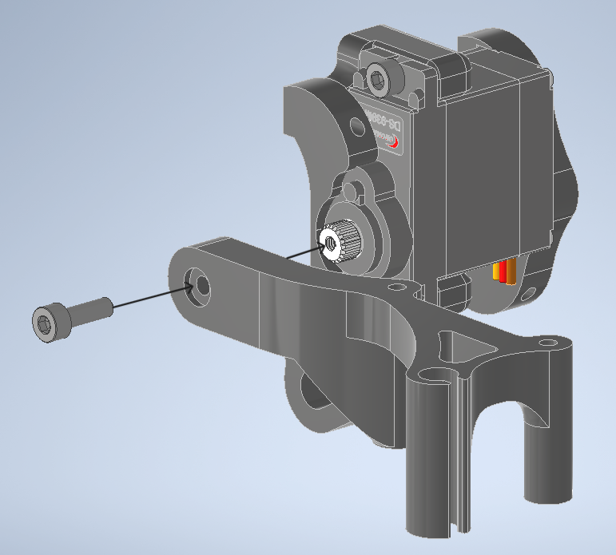

Рис. 3

> **Важно** Не перекручивайте винты и не прижимайте детали слишком плотно, чтобы снизить нагрузку на сервопривод и избежать поломок механизма в дальнейшем!

Вставьте в правую боковую стойку подшипник или пластиковую проставку под М3 с максимальным внешним диаметром до 6 мм. Прикрутите деталь к маунту винтом M3x10 до упора без усилий, чтобы она легко проворачивалась.

  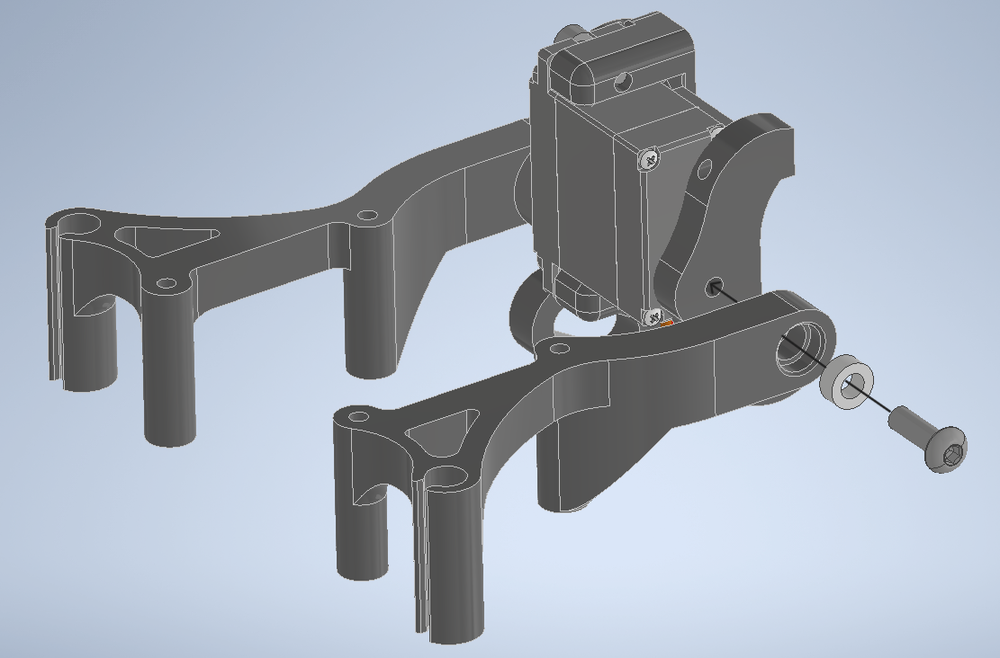

Рис. 4

### Шаг 3: Установка камер

Используется:
- Кронштейн, собранный на шаге 2;
- Фронтальная камера - 1шт;
- Вторая камера - 1шт;
- Винт M2.5x4-6 - 8шт (по 4шт на камеру).

Установите фронтальную камеру на маунт спереди, как показано на рисунке 5, используя 4 винта M2.5x4-6

  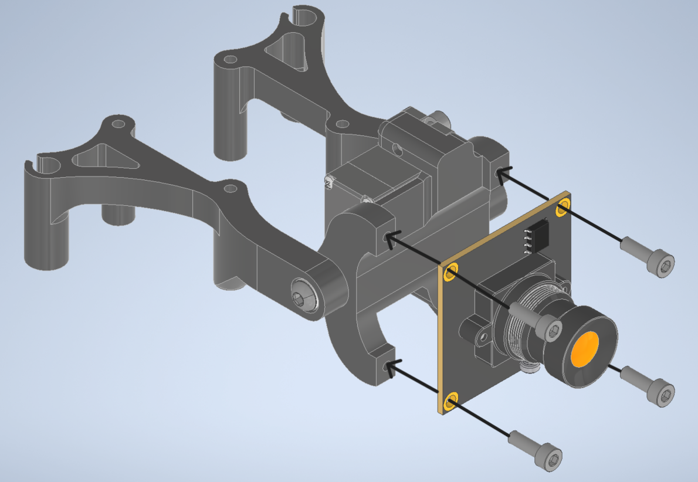
  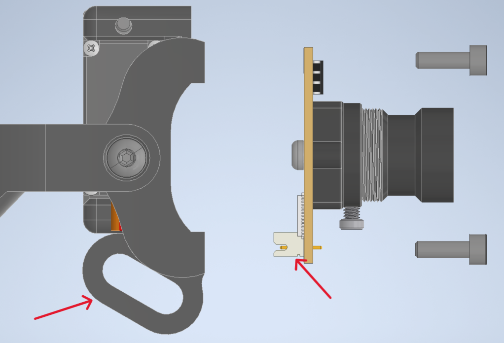

Рис. 5

> **Подсказка** Обратите внимание что разъём для кабеля находится с той же, стороны, что и фиксирующая петля провода! При подключении камеры к одноплатному компьютеру, нужно продеть конец кабеля через неё.

Установите вторую камеру так, как показано на рисунке 6, учитывая расположение разъёма и закрепив её на 4 винта M2.5x4-6.

  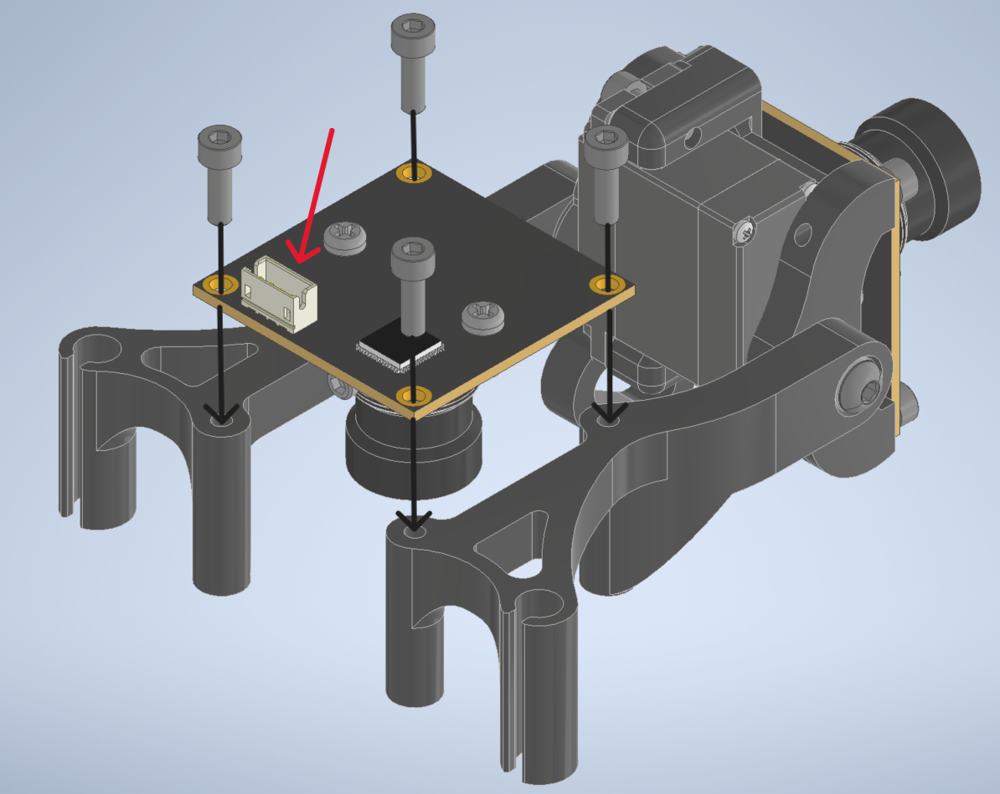

Рис. 6

### Этап 2: Установка и подключение

### Шаг 1: Установка на маунт

Используется:
- Собранный кронштейн с камерами;
- Маунт камеры - 1шт;
- Винт M2.5x4-6 - 4шт.

Собранный кронштейн установите на маунт камеры, как показано на рисунках 7 и 8, и закрепите на 4 винта M2.5x4-6

  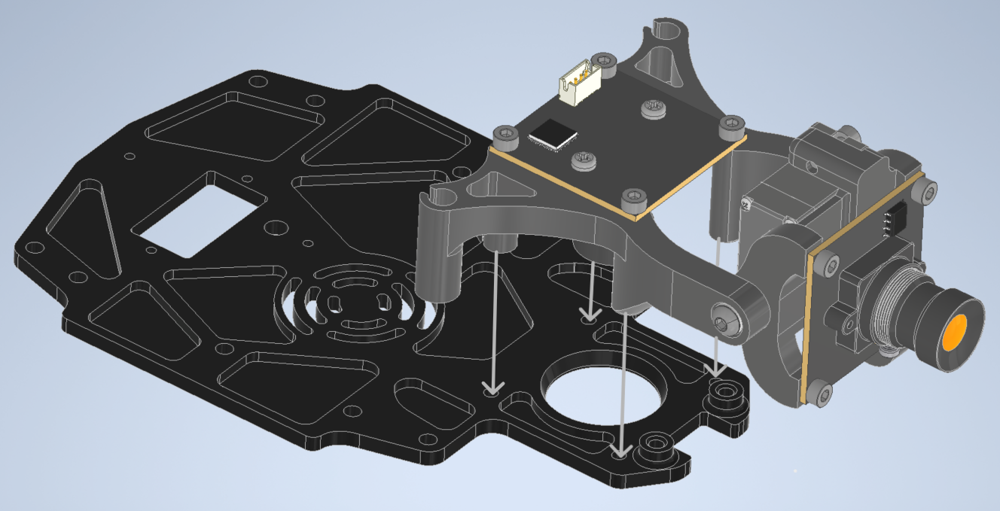

Рис. 7

  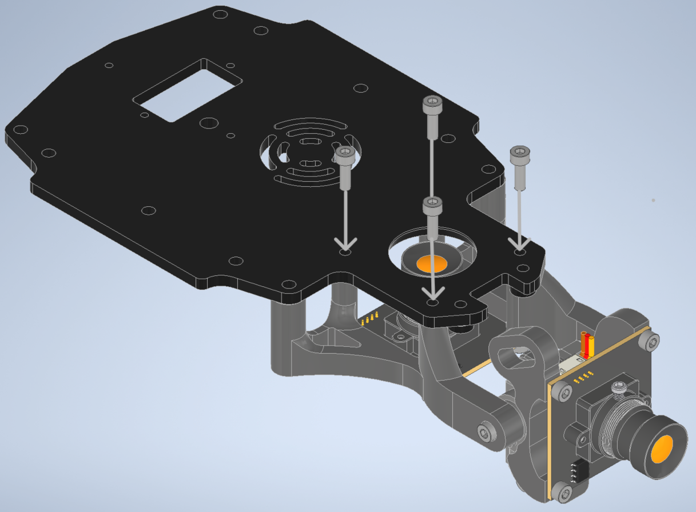

Рис. 8

### Шаг 2: Установка на дрон

Используется:
- Конструкция, собранная на шаге 1;
- Передние алюминиевые стойки;
- Винт M3x4-6 - 4шт.

Получившуюся конструкцию оденьте на передние алюминиевые стойки до упора и зафиксируйте с помощью 4 винтов M3x4-6, как показано на рисунках 9 и 10

  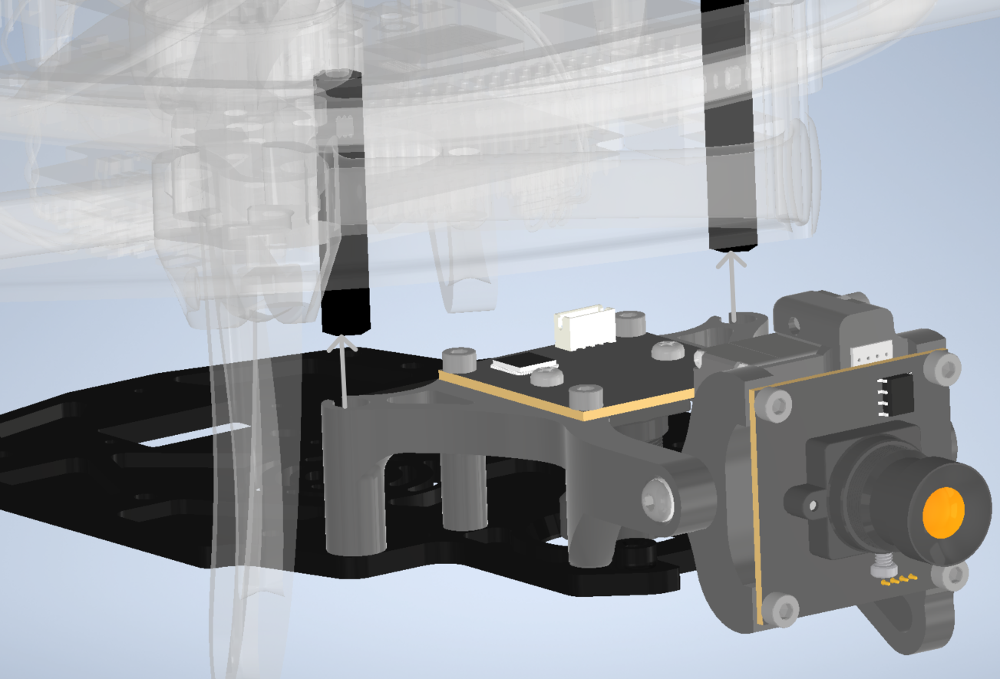

Рис. 9

  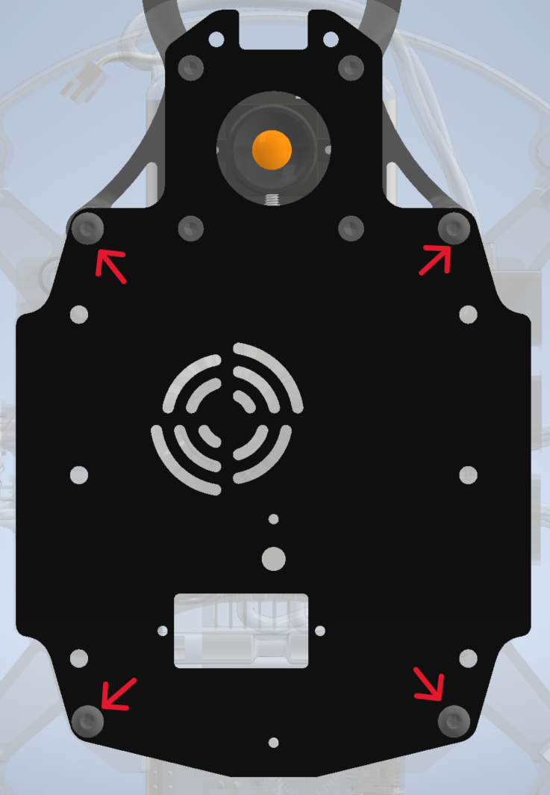

Рис. 10

### Шаг 3: Подключение камер

Подключите камеры к Orange через разъёмы USB, как показано на рисунках 11 и 12.

  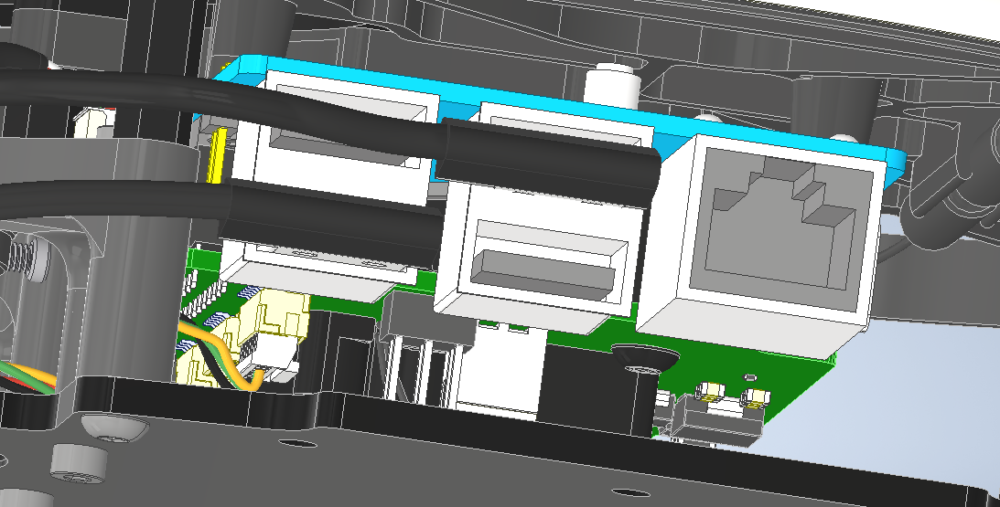

Рис. 11

  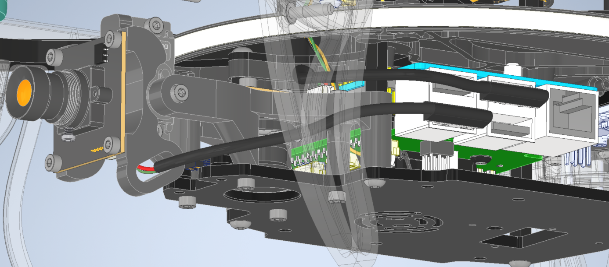

Рис. 12

> **Важно** Если камеры инициализируются в неверном порядке (это можно проверить через WEB-интерфейс дрона во вкладке "Image Topics"), то необходимо поменять кабели местами.

### Шаг 4: Подключение сервопривода

Аккуратно проведите кабель от сервопривода к полётному контроллеру так, чтобы он не пересекался с пропеллерами. Подключите провод к гребёнке сзади сигнальным пином вверх (жёлтым проводом). Для подключения можно использовать 2 крайних столбца пинов, это AUX1 и AUX2, соответственно.

  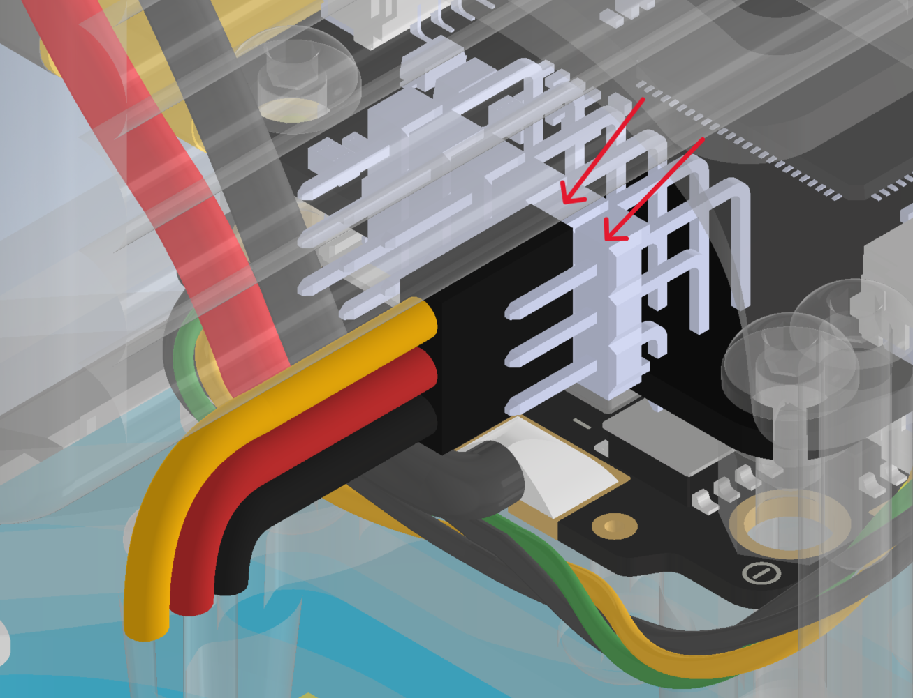

Рис. 13

Допускается подключение сервоприводов к шилду OrangePi. Для этого провод нужно соединить с пинами над разъёмами USB, как показано на рисунке 14.

  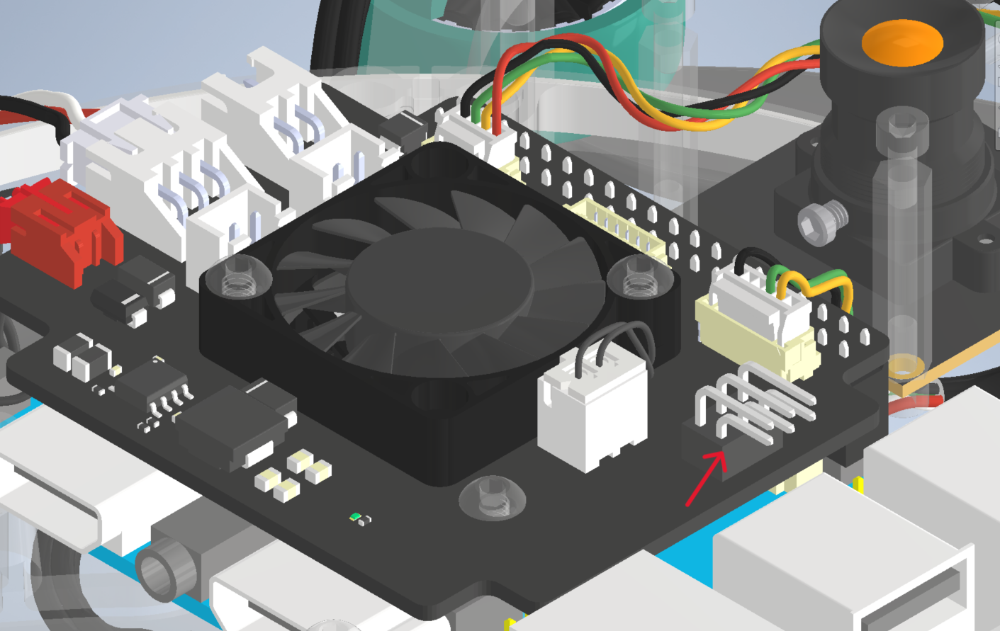
  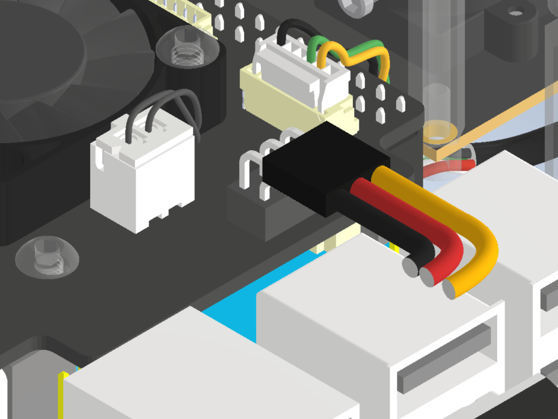

Рис. 14

Подробнее о подключении сервоприводов к OrangePi написано в [данной статье](gpio.md).
