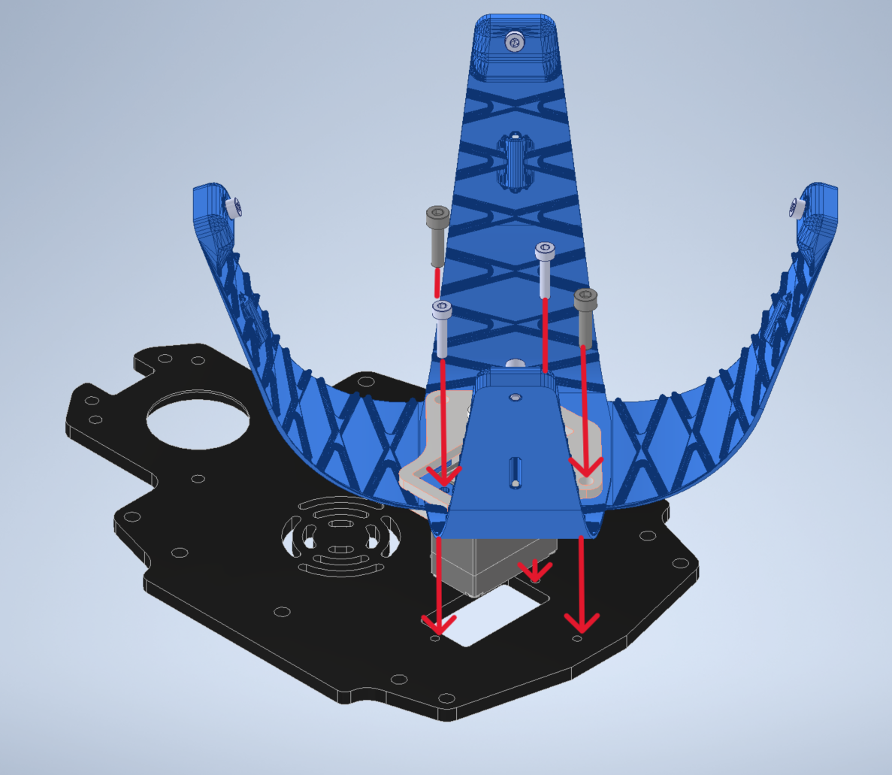
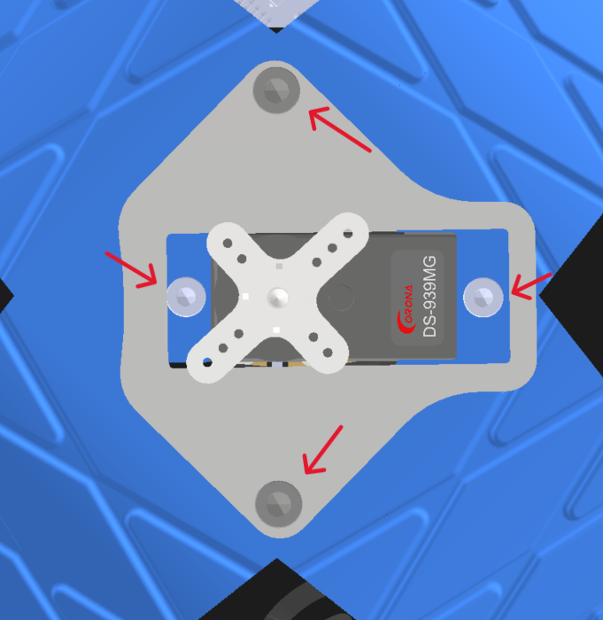
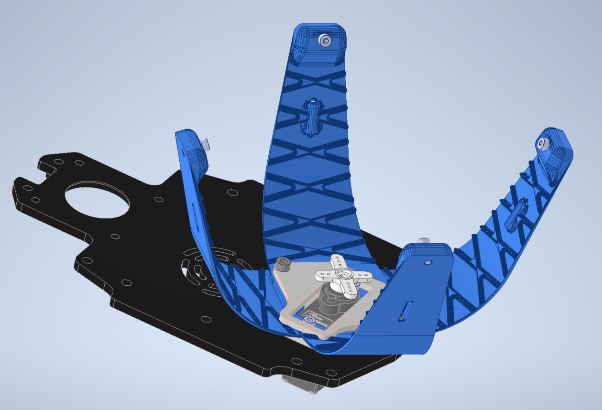
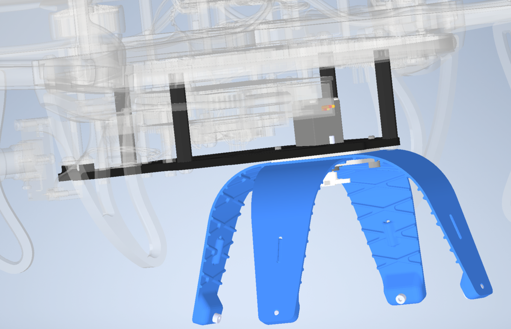
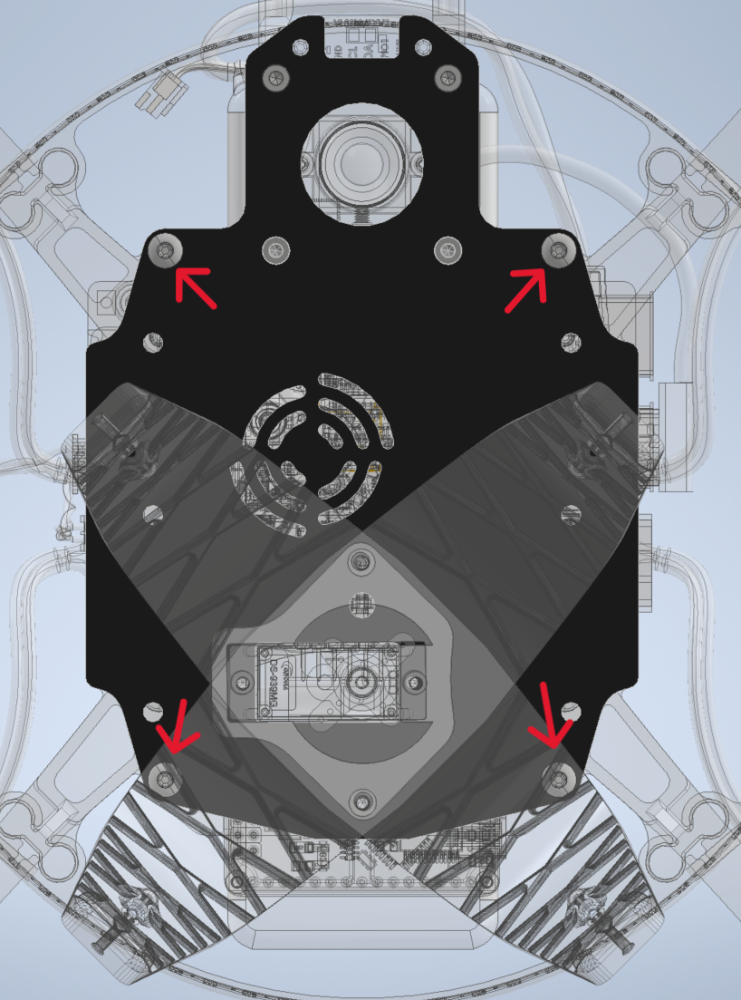
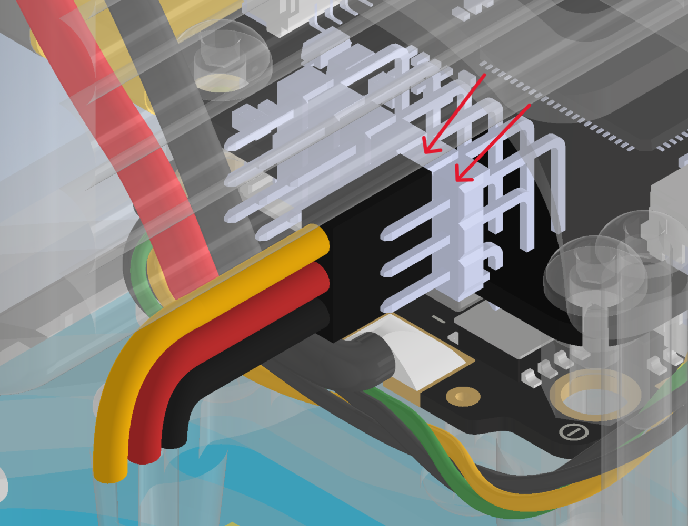
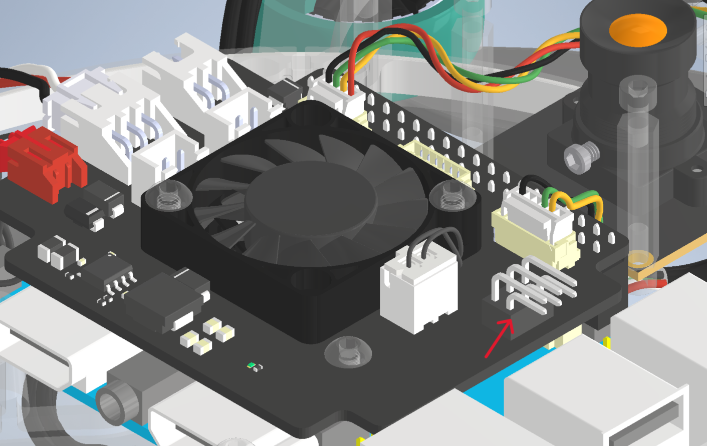
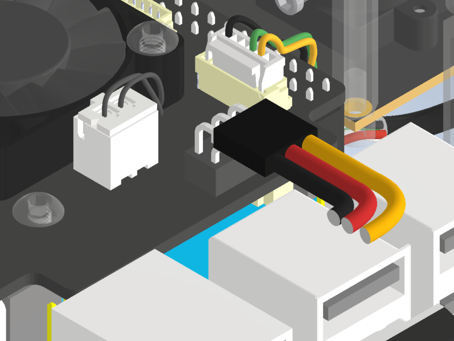

# Установка механического захвата тип 1

### Шаг 1: Крепление захвата к маунту камеры

Используется:
- Собранный механический захват;
- Маунт камеры - 1шт;
- Саморез M2x10 - 4шт.

Установите собранный механический захват на маунт камеры, как показано на рисунке 1, используйте 4 самореза M2x10.

  
  

Рис. 1

Должна получиться конструкция, как на рисунке 2

  

Рис. 2

### Шаг 2: Установка на дрон

Используется:
- Маунт с захватом, собранный на шаге 1;
- Винт M3x8 - 4шт.

Маунт с захватом следует установить на дрон, соблюдая ориентацию.

  

Рис. 3

Зафиксируйте готовую конструкцию, используя 4 винта M3x8

  

Рис. 4

### Шаг 3: Подключение к полетному контроллеру

Аккуратно проведите кабель от сервопривода к полётному контроллеру так, чтобы он не пересекался с пропеллерами. Подключите провод к гребёнке сзади сигнальным пином вверх (жёлтым проводом). Для подключения можно использовать 2 крайних столбца пинов, это AUX1 и AUX2, соответственно.

  

Рис. 5

Допускается подключение сервоприводов к шилду OrangePi. Для этого провод нужно соединить с пинами над разъёмами USB, как показано на рисунке 6.

  
  

Рис. 6

Подробнее о подключении сервоприводов к OrangePi написано в [данной статье](gpio.md).
