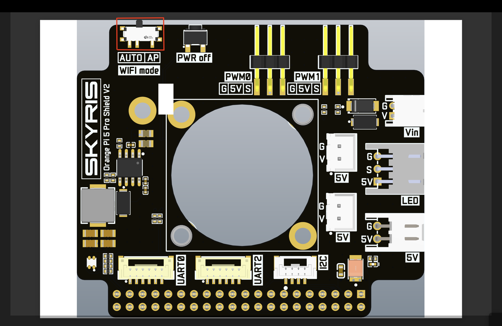
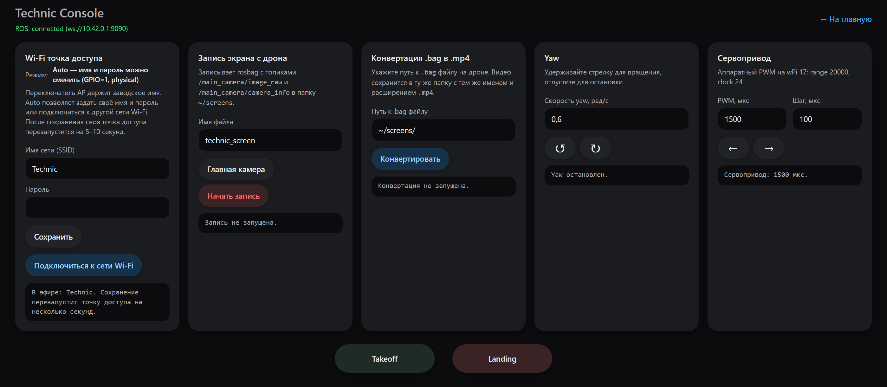

# Настройка сети

По умолчанию имя точки: technic-xxxx, пароль: technicwifi

Адрес Web-интерфейса:  [http://10.42.0.1](http://10.42.0.1:8000/technic)

Если вы хотите поменять имя wifi или пароль откройте страницу Technic Console в веб-интерфейсе

На новой версии SKYRIS SHIELD есть возможность физически поменять ползунок режима wifi

  

Режим Ap раздает стандартную сеть wifi: technic-xxxx без возможности поменять имя или пароль

> **Подсказка** Если по какой-то причине в режиме AUTO у вас сломался wifi, вы всегда можете физически передвинуть ползунок на режим AP и у вас будет раздаваться стандартная сеть wifi technic-xxxx. В режиме AP пароль стандартный и неизменяемый technicwifi. 

В режиме AUTO также изначально стандартное имя wifi technic-xxxx и пароль technicwifi. Вы можете поменять имя или пароль или подключиться к общей сети. Для этого нужно физически переключить ползунок на режим AUTO. 

Далее на странице Technic Console вы можете ввести имя и пароль или подключиться к общей сети

  

