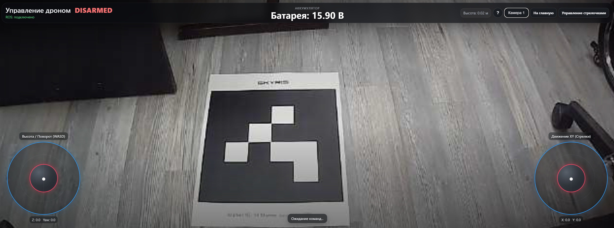
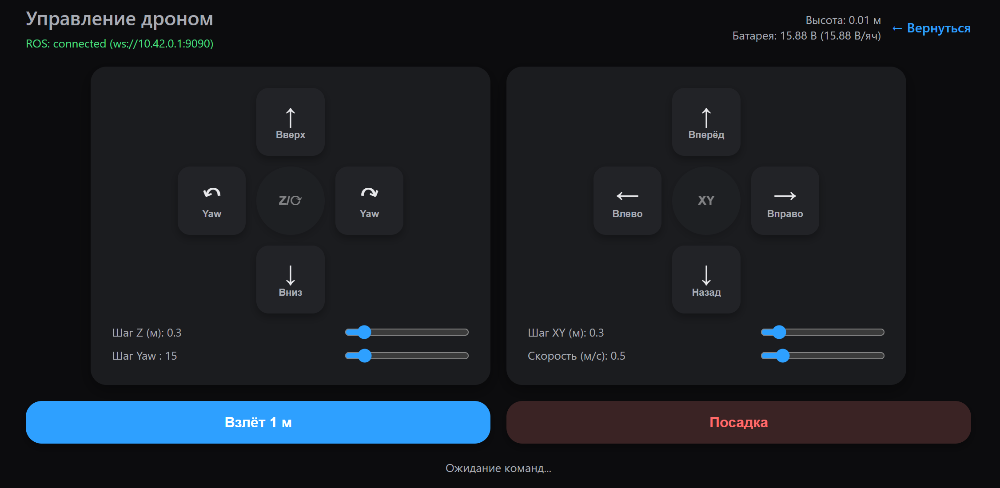

# Ручное управление Technic 6S

В веб-интерфейсе вы можете запустить дрон Technic 6S в ручном управлении. Реализованы 2 режима: управление с помощью джойстиков и управление с помощью стрелок
## Управление дроном с помощью джойстиков

### Перед полётом

На всякий случай держите рядом пульт радиоуправления, чтобы при необходимости можно было взять управление на себя. Перед взлётом убедитесь, что интерфейс корректно отображается на вашем устройстве: камера видна, оба джойстика полностью помещаются на экране и ничто не мешает управлению. Если что-то отображается неправильно, не взлетайте, пока не исправите проблему.

### Что отображается на экране

В верхней части экрана находятся статус дрона, заряд аккумулятора и высота полёта. Статус `DISARMED` означает, что моторы выключены, а `ARMED` — что они включены. Кнопка «?» открывает подсказку по запуску моторов, а кнопки «Камера 1» и «Камера 2» позволяют переключаться между камерами.

Левый джойстик, расположенный внизу слева, отвечает за высоту и поворот дрона: движение вверх и вниз регулирует высоту, а влево и вправо — поворачивает дрон. Правый джойстик, находящийся внизу справа, отвечает за перемещение вперёд, назад, влево и вправо.
### Запуск и взлёт

На телефоне или планшете одновременно переместите левый джойстик в нижний правый угол, а правый — в нижний левый. Удерживайте их в этом положении примерно одну секунду. На компьютере, если не получается одновременно переместить оба джойстика, нажмите клавишу `Пробел` один раз.
### Управление с клавиатуры

Если вы управляете дроном с компьютера, можно использовать клавиатуру. Клавиши `W` и `S` отвечают за набор и снижение высоты, `A` и `D` — за поворот влево и вправо. Стрелки на клавиатуре управляют перемещением: `↑` — вперёд, `↓` — назад, `←` — влево, `→` — вправо.

Когда вы отпускаете джойстики, дрон останавливает движение и старается удерживать текущую позицию.

### Посадка

Чтобы посадить дрон, опустите левый джойстик, отвечающий за газ и высоту, до упора вниз и удерживайте его в этом положении. После приземления через короткое время моторы должны выключиться автоматически.

## Управление дроном с помощью стрелок

Для более упрощенного запуска можно переключиться на режим полета по стрелкам, 
## Перед полётом

На всякий случай держите рядом пульт радиоуправления, чтобы при необходимости можно было взять управление на себя.

### Запуск и взлёт

На телефоне или планшете нажмите кнопку Взлететь на 1 метр, это поднимет дрон по z на 1 метр в режиме body. Как только дрон достигнет 1 метра в высоту, вы сможете им управлять с помощью стрелок.
### Управление с клавиатуры

Если вы управляете дроном с компьютера, можно использовать клавиатуру. Также можете курсором нажимать на стрелки в веб-интерфейсе. 
### Посадка

Чтобы посадить дрон нажмите на на кнопку Посадка.

